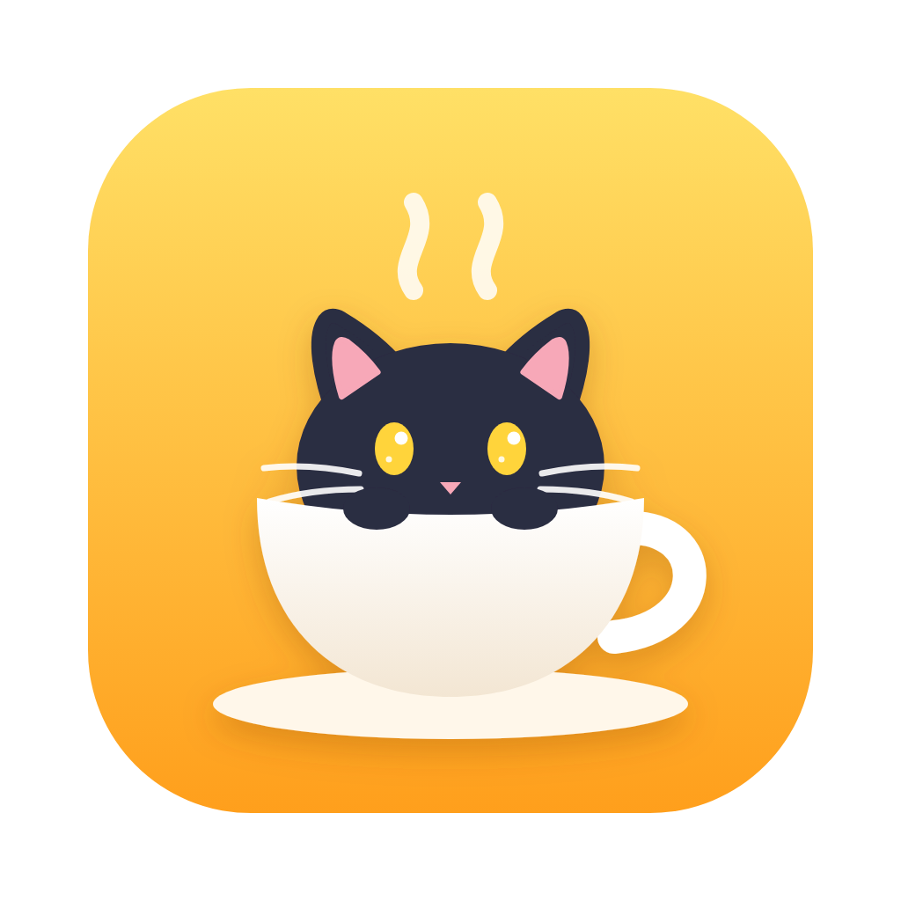
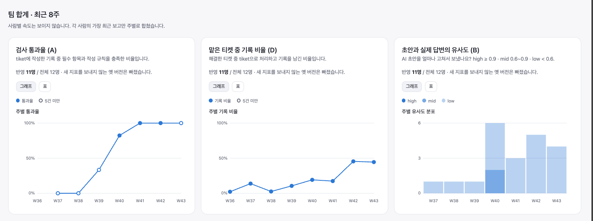
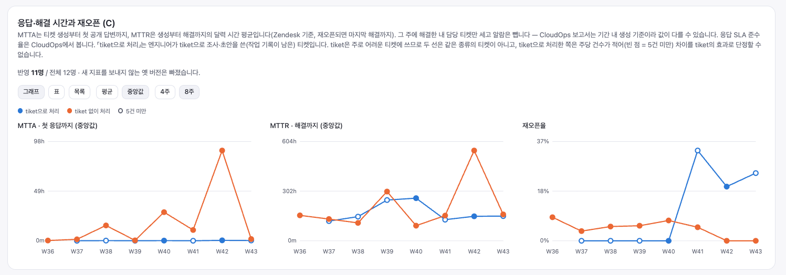
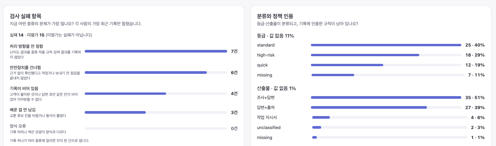
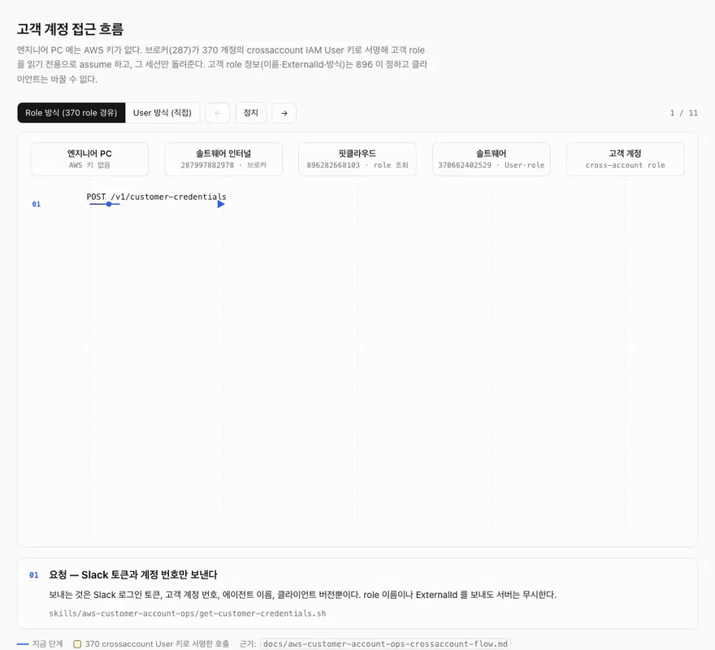

<div align="center">



# tiket

### 고객 티켓을 AI가 조사하고 답변 초안까지 쓰는 MSP 작업 공간

**보내는 건 항상 사람이에요.**


[빠른 시작](#빠른-시작) · [써 보니](#써-보니) · [AI가 절대 안 하는 것](#ai가-절대-안-하는-것) · [문서](#문서)

</div>

> [!IMPORTANT]
> # 📌 신규 기능 개발 잠정 중단 — ITSM 과 통폐합 검토 중 (2026-10-28)
>
> - **경영진이 인지한 프로젝트예요.** 2026-10-28 ITSM 회의에서 공유했어요. 기록은 [`policy/pending-review.md` 결정 완료 11](policy/pending-review.md#결정-완료-11--tiket-프로젝트-승인과-itsm-통폐합-2026-10-28).
> - **기능을 ITSM 과 비교·분석해 통폐합할 예정이에요.** 그래서 **새 기능은 당분간 만들지 않아요.**
> - **지금 쓰는 기능은 그대로 써요.** 버그 수정과 통폐합에 필요한 정리만 해요.

<div align="center">
<br />

<br /><sub>팀 사이트의 사용 지표 (2026-10-22, W36–W43) — <a href="docs/metrics.md">지표 전체 보기</a></sub>
</div>

---

티켓 번호 하나를 주면 AI가 대화를 가져와 조사하고, 근거마다 **확인 / 추측 / 모름** 딱지를 붙여 기록을 남긴 뒤,
팀 답변 템플릿 모양으로 초안을 써요. 기술 문의뿐 아니라 보안·계약 문의, 티켓 번호 없이 메일로 온 건도 똑같이 처리해요.

- **조사 기록이 남아요.** 다음 사람이 처음부터 다시 안 봐도 돼요.
- **추측을 확인처럼 보내지 않아요.** 출처 없는 `[확인]` 은 검사기가 짚어요.
- **배운 게 팀 자산이 돼요.** 한 사람이 넘어진 곳이 승인을 거쳐 모두의 오답 노트가 돼요.

Claude Code · Kiro · Codex · Hermes 중 무엇을 써도 같은 규칙으로 움직여요.

## 빠른 시작

**1. 처음 한 번만 — 받고, 정식 버전으로 맞추기**

```bash
git clone https://github.com/example-org/tiket.git
cd tiket
git reset --keep "$(git describe --tags --abbrev=0 --match 'v[0-9]*')"
```

세 번째 줄이 중요해요. 그냥 받으면 **아직 개발 중인 `main`** 이 와요.
이 줄이 가장 최근 **정식 버전(`vX.Y.Z`)** 으로 맞춰 줘요. 그 뒤로는 새 버전이 나오면 알아서 올라가요.

> `git clone --branch v0.1.1` 처럼 버전을 찍어서 받지 마세요. 그러면 자동 업데이트가 멈춰요.

**2. 설치하고 점검하기**

```bash
bash scripts/onboarding.sh          # macOS / Linux
pwsh -File scripts/onboarding.ps1   # Windows
```

> [!IMPORTANT]
> **온보딩 스크립트는 꼭 돌려요.** 아래 키를 터미널에서 물어보고 확인한 뒤 `~/.config/msp/` 에 저장해요.
> 건너뛰어도 설치는 끝나지만 **그 기능은 동작하지 않아요.** 특히 ITSM 토큰은 없어도 AI가 그냥 진행해서, 빠진 걸 모르고 지나가기 쉬워요.
>
> | 키 | 없으면 | 발급 |
> |---|---|---|
> | **Zendesk API 토큰** | 티켓 번호로 대화를 못 가져와요 | Zendesk 관리센터 → 앱 및 통합 → API → Zendesk API → 토큰 추가 |
> | **ITSM 토큰** (본인 것) | 고객 특이사항(접근 금지·주의점)을 못 읽고 "특이사항 미확인" 으로 진행해요 | ITSM → 오른쪽 위 내 이름 → Profile → API 토큰 → 토큰 발행 |
> | **빌링 플랫폼 API 키** | 고객 AWS·비용 조회가 안 돼요 | 빌링 플랫폼 → 계정 설정 → API Token Setting |
>
> 고객 AWS를 보려면 키와 별개로 **Slack 로그인**도 한 번 해야 해요 (1시간 유지) — [`ONBOARDING.md` 5절](ONBOARDING.md#5-로그인-처음-한-번-브라우저가-열립니다).
> 키 값은 채팅·이슈·PR 에 붙여넣지 마세요. 다 됐는지는 `bash scripts/onboarding.sh --check` (Windows: `-Check`) 로 봐요.
> 어느 파일에 뭐가 저장되는지는 [`docs/local-files.md`](docs/local-files.md) 에 있어요.

키는 직접 넣어야 해요. 다 넣은 뒤 결과를 읽기 어려우면 AI에게 해석만 부탁해도 돼요.

```
bash scripts/onboarding.sh --check 를 돌리고 결과를 설명해줘
```

**3. `tiket` 폴더를 열기 — 꼭 지켜요**

AI 도구는 **항상 `tiket` 폴더 자체를 열어서** 시작해요. 상위 폴더를 열고 그 안의 `tiket` 에서 일하면 안 돼요.

```bash
cd tiket && claude        # Claude Code · Codex · Kiro CLI · Hermes — tiket 안에서 실행
```

Kiro IDE 는 **File → Open Folder** 로 `tiket` 을 고르세요. 다른 폴더와 같이 봐야 하면
**Add Folder to Workspace** 로 `tiket` 을 루트로 추가해요.

> **이건 권장이 아니라 필수예요.** 규칙·훅·도구 설정(`.kiro/`, `.claude/`, `.codex/`, `AGENTS.md`)은
> **연 폴더의 맨 위**에 있을 때만 읽혀요. 상위 폴더를 열면 AI 가 "보내지 않는다, 고객 계정을 바꾸지 않는다" 는
> 규칙 없이 일하고, 자동 업데이트도 멈춰요. 에러는 안 나요 — 조용히 빠져요.

**4. 일 맡기기**

```
티켓 100008 처리해줘
```

AI가 조사하고 초안을 써요. 확인하고 보내는 건 여러분이에요.

처음이라면 [`ONBOARDING.md`](ONBOARDING.md) 가 설치부터 첫 연습까지 안내해요.

## 써 보니

모든 숫자는 각 PC 가 보낸 **숫자만** 모은 팀 합계예요 — 고객 내용은 안 가요([무엇이 나가나](docs/data-and-lessons.md)).





빨라졌다고 말하지 않아요. tiket 은 주로 어려운 티켓에 쓰여서 두 선은 같은 종류의 티켓이 아니에요.
지표마다 무엇을 세는지는 [`docs/metrics.md`](docs/metrics.md) 에 있어요.

## AI가 절대 안 하는 것

| 안 하는 것 | 어떻게 막아요? |
|---|---|
| 고객에게 메일·댓글 보내기 | 보내는 기능 자체가 없어요. 초안까지만 |
| 고객 AWS 설정 바꾸기 | 서버가 **보기 전용**으로 막아요. AI가 실수해도 안 뚫려요 |
| 고객 정보를 Git에 올리기 | `tickets/`·`customers/` 는 올리려고 해도 push에서 막혀요 |
| AWS 원래 청구 금액 알려 주기 | 고객에게는 빌링 플랫폼에서 정리된 금액만 써요 |
| 비밀번호·키 출력하기 | 규칙으로 금지하고, 전송할 때도 한 번 더 걸러요 |

### 고객 AWS 는 이렇게 보기 전용이 돼요

엔지니어 PC 에는 AWS 키가 없어요. 서버가 신원을 확인하고, 읽기 전용 세션만 만들어 돌려줘요.



단계마다 무슨 일이 일어나는지는 [`docs/aws-customer-account-ops-crossaccount-flow.md`](docs/aws-customer-account-ops-crossaccount-flow.md) 에 있어요.

## 문서

| 문서 | 언제 읽어요? |
|---|---|
| [`ONBOARDING.md`](ONBOARDING.md) | 처음 시작할 때. 설치부터 첫 연습까지 |
| [`docs/how-it-works.md`](docs/how-it-works.md) | 티켓 한 건이 처리되는 순서, `policy`·`playbooks`·`pitfalls` 의 차이, 근거 딱지, 답변 템플릿 |
| [`docs/aws-customer-account-ops-crossaccount-flow.md`](docs/aws-customer-account-ops-crossaccount-flow.md) | 고객 AWS 조회가 어떤 계정·권한을 거쳐 읽기 전용 세션을 받는지 궁금할 때. 흐름 애니메이션은 [`.slides.html`](docs/aws-customer-account-ops-crossaccount-flow.slides.html) |
| [`docs/metrics.md`](docs/metrics.md) | 팀 사이트의 사용 지표 화면 |
| [`docs/local-files.md`](docs/local-files.md) | 내 PC 의 `~/.config/msp/` 등에 무엇이 저장되고 누가 쓰는지 궁금할 때 |
| [`docs/data-and-lessons.md`](docs/data-and-lessons.md) | 밖으로 나가는 데이터와 끄는 법, 교훈이 팀 자산이 되는 길 |
| [`docs/personal-ai-settings.md`](docs/personal-ai-settings.md) | 개인 AI 설정이 이상하게 돌아가게 만들 때 |
| [`TECHNICAL.md`](TECHNICAL.md) | 폴더마다 **언제 읽히고, 누가 채우는지** |
| `CLAUDE.md` · `AGENTS.md` | AI가 제일 먼저 읽는 규칙. 사람도 한 번 읽어 두면 좋아요 |
| [`DISTRIBUTION.md`](DISTRIBUTION.md) | 배포 방식 |
| `evals/` · `development/` | AI 가 규칙대로 움직이는지 **재 본 결과**, **왜 이렇게 만들었는지** |
