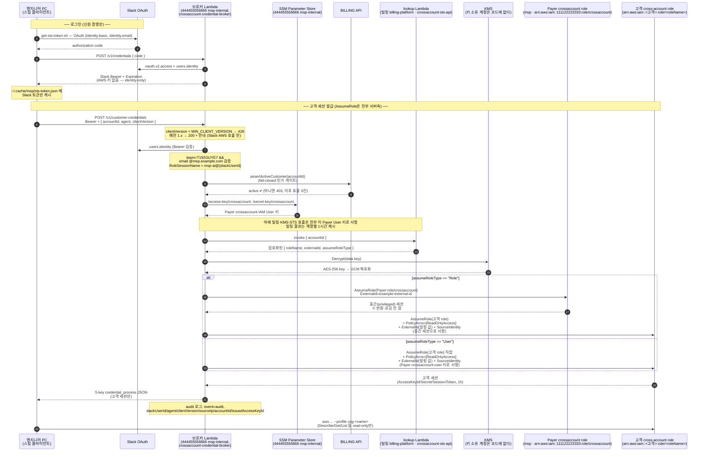
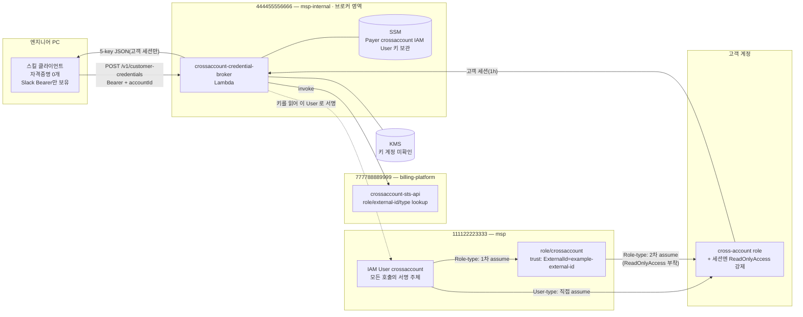

# aws-customer-account-ops — Cross-Account 접근 전체 Flow

> 이 문서는 `skills/aws-customer-account-ops` 스킬이 **111122223333**(이하 `Payer`) 계정의
> cross-account IAM Role을 경유해 고객 AWS 계정의 read-only 세션을 얻는 과정을 설명한다.
> 근거는 모두 **서버 저장소**(`example-org/credential-broker`, 2026-10-22 에 `support-skills` 에서 이름을 바꿨다)의 브로커 Lambda 코드와 **클라이언트 스킬**
> (`skills/aws-customer-account-ops/*.sh`) 구현이다. 추측이 아니라 코드로 확인한 흐름만 담았다.

> **계정 표기 (헷갈리지 말 것)**
> - `444455556666` = **msp-internal (MSP 회사 인터널)** — 브로커 Lambda가 사는 계정.
> - `111122223333` = **msp (MSP 회사 계정)** — 브로커가 모든 AWS 호출에 쓰는 **crossaccount IAM User**와, Role-type 체인의 중간 허브 role이 사는 계정.
> - `777788889999` = **billing-platform (MSP 회사_빌링 플랫폼)** — 계정별 cross-account role 메타데이터를 돌려주는 lookup Lambda(`crossaccount-sts-api`)가 사는 계정.

## 한 줄 요약

엔지니어 PC의 스킬 클라이언트는 **AWS 자격증명을 한 바이트도 쥐지 않는다.** Slack 로그인으로
신원만 증명하고, cross-account `AssumeRole`과 `ReadOnlyAccess` 부착은 **브로커 Lambda가 서버측에서**
수행한다. 브로커는 인터널 에 살지만 빌링 조회·KMS 복호화·AssumeRole 은 전부 **`Payer` 의 crossaccount IAM User 키**로 서명한다
(키는 인터널 SSM 에 보관). Role-type 고객이면 `Payer` 의 **중간 허브 role**(`arn:aws:iam::111122223333:role/crossaccount`)을 한 번 더 거친다.

## 등장 주체

| 주체 | 정체 | 코드 근거 |
|---|---|---|
| 스킬 클라이언트 | 엔지니어 PC의 `get-sts-token.sh` / `get-customer-credentials.sh` | `skills/aws-customer-account-ops/` |
| 브로커 Lambda | `crossaccount-credential-broker` (444455556666 = `msp-internal`) | `infra/lambda/crossaccount-credential-broker/index.mjs` |
| crossaccount IAM User | **111122223333** 의 IAM User. 장기 키를 인터널 SSM 에 두고, 브로커가 읽어 빌링 invoke·KMS Decrypt·STS AssumeRole 을 서명한다 (Lambda 실행 역할에는 sts/lambda/kms 권한이 없다) | `index.mjs` `getCrossAccountKeys`, `template.yaml` `/access-key/crossaccount` 주석 |
| lookup Lambda (빌링) | `arn:aws:lambda:...:777788889999:function:crossaccount-sts-api` — `billing-platform`(MSP 회사_빌링 플랫폼) 계정, 계정별 role/external-id/type을 KMS 암호화해 반환 | `lib/account-lookup.mjs` `LAMBDA_ARN` |
| **Payer crossaccount role** | `arn:aws:iam::111122223333:role/crossaccount` — `msp` 계정, Role-type 체인의 중간 허브 | `lib/customer-assume.mjs` `INTERMEDIATE_ROLE_ARN` |
| 고객 cross-account role | 고객 계정에 존재하는 `arn:aws:iam::<고객>:role/<roleName>` | `lib/customer-assume.mjs` `roleArn` |

## 왜 `Payer` 계정인가

고객 role로 들어가는 방식(`assumeRoleType`)은 **빌링 lookup이 계정별로 알려준다.** 두 가지다
(`lib/customer-assume.mjs` 토폴로지 주석):

- **User-type** — `crossaccount-user`(111122223333 의 IAM User) → 고객 role **직접** assume. 중간 홉 없음.
- **Role-type** — `crossaccount-user` → **`Payer` crossaccount role** → 고객 role. 즉 role chaining이고,
  이때 `Payer`의 신뢰 정책이 `ExternalId=example-external-id`를 **요구**한다(없으면 AccessDenied).

즉 `Payer` 은 두 방식 모두에 등장한다 — User-type 은 `Payer` 의 IAM User 가 바로 고객 role 을, Role-type 은 그 User 가
`Payer:role/crossaccount` 를 거쳐 고객 role 을 assume 한다. 그래서 고객 role 의 신뢰 정책은 이 둘 중 하나를 신뢰해야 동작한다(실제 원문은 아래 unknown). 이 중간 세션은 권한이 있는
privileged 세션이라 **절대 클라이언트로 반환되지도, 로그에 남지도 않는다**(`BRK-07`).

## 전체 Flow (시퀀스)

## 토폴로지 (계정 경계)

## 보안 불변식 (코드에서 강제되는 것)

1. **클라이언트는 privileged 자격증명을 쥐지 않는다.** `get-sts-token.sh`는 로그인 응답에서
   AWS 키 필드(`AccessKeyId/SecretAccessKey/SessionToken`)를 **디스크·stdout 어디에도 쓰지 않고**
   Slack 토큰만 캐시한다. `/v1/credentials`도 서버측에서 identity-only로 바뀌어 AWS 키를 아예
   반환하지 않는다(`buildLoginIdentityResponse`).
2. **role 이름은 클라이언트가 못 정한다.** `roleName`/`externalId`/`assumeRoleType`은 요청 body가
   아니라 **빌링 lookup**에서만 온다. body의 `accountId`, `agent` 외 모든 신원/role 필드는 무시된다
   (confused-deputy / arbitrary-role 차단, `lib/account-lookup.mjs` 주석).
3. **read-only는 IAM 불변식이다.** 최종 고객 AssumeRole은 **항상** `PolicyArns=[ReadOnlyAccess]`를
   서버측에서 부착한다(`READONLY_POLICY_ARN`). 세션 정책은 role 권한과 **교집합**이라, 고객 role에
   AdministratorAccess가 있어도 세션은 ReadOnly로 제한된다. 클라이언트에는 이를 끌 경로가 없다.
4. **인가가 privileged 호출보다 먼저다.** `assertActiveCustomer`(fail-closed)가 빌링/STS 호출
   **이전에** 실행되어, 인가되지 않은 `accountId`는 privileged 호출 0건으로 403 거부된다(open-proxy 차단).
5. **중간 세션은 새어나가지 않는다.** Role-type의 `Payer` 중간 세션은 최종 고객 세션을 만드는 데만
   쓰이고 반환·로깅되지 않는다. 응답은 고객 세션 5개 필드뿐이다(`buildCustomerCredentialResponse`).
6. **세션 수명 1h.** `DurationSeconds`는 3600으로 clamp된다. role chaining 하드캡과 일치하며,
   만료 시 `get-customer-credentials.sh`가 동일 호출로 재발급한다.
7. **고객 CloudTrail에는 MSP 식별자만 보인다.** `RoleSessionName = msp-ai@{slackUserId}`, `SourceIdentity = {slackUserId}`.
   고객 role 신뢰 정책이 `sts:SetSourceIdentity` 를 허용하지 않으면 SourceIdentity 없이 한 번 더 시도하고 `assume.sourceIdentity.degraded` 를 남긴다.
   AI 도구 이름은 세션명에 없고, 사내 감사 로그(`event: audit`의 `agent` 필드)에만 남는다.
8. **낡은 클라이언트는 신원 확인 전에 막힌다.** `clientVersion` 이 `MIN_CLIENT_VERSION` 보다 낮은 `tiket-v*` 는 426,
   예전 1.x 스킬은 200 + 안내로 거절되고 `client.legacy.refused` 로그가 남는다 — Slack·AWS 호출 0건.

## 코드 이 변경 흐름을 바꾸면 봐야 할 곳

| 관심사 | 파일 |
|---|---|
| 로그인 / Slack 토큰 캐시 | `skills/aws-customer-account-ops/get-sts-token.sh` |
| 고객 세션 요청(클라이언트) | `skills/aws-customer-account-ops/get-customer-credentials.sh` |
| 엔드포인트 라우팅 / 신원 검증 / 감사 | `credential-broker/infra/lambda/crossaccount-credential-broker/index.mjs` |
| role/external-id/type lookup | `.../lib/account-lookup.mjs` |
| **Payer 중간 홉 + 고객 AssumeRole + ReadOnly 부착** | `.../lib/customer-assume.mjs` |
| 브로커 IAM / SSM 파라미터 / API | `credential-broker/infra/template.yaml` |

## 확정 수준

- **confirmed (코드)** — 위 시퀀스·토폴로지·불변식, 그리고 계정 **번호**(444455556666 / 111122223333 / 777788889999)와
  role·Lambda·ARN은 모두 위 표의 소스 코드에서 직접 읽은 것이다.
- **confirmed (AWS 조회, 2026-10-22)** — crossaccount IAM User 는 111122223333 것이다: 인터널 SSM 의 키 ID 로 `sts get-access-key-info` 를 부른 결과(키 값은 출력하지 않았다). 인터널 에는 그 이름의 IAM User 가 없다.
- **confirmed (코드 외부)** — 계정 **이름**은 코드에 없다: `msp-internal` / `msp`는 운영자 확인,
  `billing-platform`(MSP 회사_빌링 플랫폼, 777788889999)는 BILLING 콘솔 계정 목록 스크린샷에서 확인했다(Account Name `billing-platform`, Switch Role Type `User`).
- **unknown** — KMS 키가 어느 계정 것인지(복호화는 Payer User 키로 서명한다 — 빌링 쪽 키일 가능성이 크다, 가설). 브로커 템플릿에는 KMS 권한이 없다.
- **unknown** — 고객 role의 trust policy 실제 원문(어떤 principal·조건으로 `Payer`/`crossaccount-user`를
  신뢰하는지)은 고객 계정 소유라 이 저장소에 없다. 코드가 확정하는 것은 "`Payer` 신뢰 정책이
  `ExternalId=example-external-id`를 요구한다"까지다(`customer-assume.mjs`).
