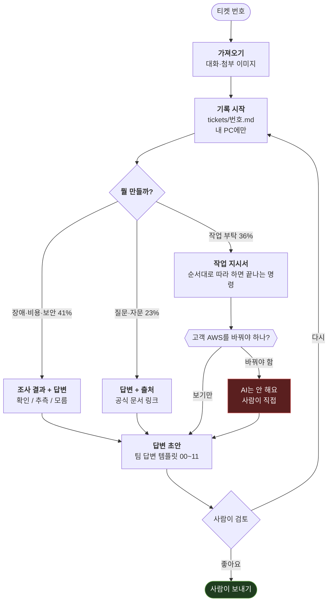

# 어떻게 돌아가요?

[← README](../README.md)

## 한마디로 뭐예요?

AI를 **새로 들어온 신입 사원**이라고 생각하면 쉬워요.

| 신입 사원에게 필요한 것 | 이 저장소에서는 |
|---|---|
| 회사 규칙 | `policy/` — 회사가 정한 규정 |
| 일하는 방법 | `playbooks/` — 무엇을 어떤 모양으로 만들지 |
| 선배들의 오답 노트 | `pitfalls/` — 실제로 한 번 틀렸던 것 |
| 빈 양식 | `templates/` — 작업 기록 양식 |
| 고객별 메모 | `customers/` — **일시 중단** (2026-10-02). 지금은 티켓 기록에 적어요 |
| 자기 업무 일지 | `tickets/` — 티켓마다 한 파일. 내 PC에만 있어요 |

신입은 이걸 **전부 외우지 않아요.** 지금 일에 필요한 것만 찾아 봐요. AI도 똑같아요.

---

## 제일 헷갈리는 셋: policy · playbooks · pitfalls

셋 다 "규칙 같은 것"이라 헷갈려요. **누가 정하느냐**로 나누면 쉬워요.

| | `policy/` | `playbooks/` | `pitfalls/` |
|---|---|---|---|
| **한마디로** | 회사 규칙 | 우리 일하는 방법 | 오답 노트 |
| **학교로 치면** | 교칙 | 답안 쓰는 법 | 오답 노트 |
| **누가 정해요?** | 회사 (팀 리드 같은 규정 주인) | 이 저장소 관리자 | 현장에서 확인된 것을 관리자가 승인 |
| **AI가 묻는 질문** | "이거 해도 돼요?" | "뭘, 어떤 모양으로 만들어요?" | "여기서 넘어진 적 있어요?" |
| **언제 읽어요?** | 주제가 맞는 카드만 | 매 티켓 (필요한 부분만) | 주제가 걸릴 때만 |
| **예시** | 비용 문의는 CSR에 넘긴다 | 답변엔 근거마다 출처를 단다 | 고객은 AWS 콘솔의 Savings Plans 화면을 못 봐요. 빌링 플랫폼으로 안내해야 해요 |
| **지금 몇 개** (2026-10-24) | 카드 25장 (확정 24 · 초안 1) | 파일 6개 | 5개 |

### 새 내용이 생기면 어디에 넣어요?

```
회사가 정한 거예요?              → policy/
우리가 이렇게 하기로 한 거예요?   → playbooks/
실제로 한 번 틀려 본 거예요?      → pitfalls/
```

> **주의:** `policy/` 카드에는 아직 **초안(draft)** 이 섞여 있어요.
> 초안 카드만 보고 고객에게 "규정상 이렇습니다"라고 말하면 안 돼요. 참고만 해요.

---

## 티켓 한 건이 처리되는 순서



비율은 실제 티켓 65건을 세어 본 값이에요.

### 결과물이 왜 셋이에요?

필요한 게 다르기 때문이에요.

| 종류 | 고객에게 보내는 답 | 진짜 중요한 것 |
|---|---|---|
| 작업 지시서 | "설정했습니다" 한 줄 | 실행하는 사람이 **그대로 따라 하면 끝나는 명령 순서** |
| 조사 결과 + 답변 | 원인과 해결 | 무엇을 **확인했고, 무엇은 추측이고, 무엇은 모르는지** |
| 답변 + 출처 | 답변 그 자체 | **출처.** 틀려도 티가 안 나는 종류라 출처가 생명이에요 |

### 답변은 팀 답변 템플릿 모양이에요 (2026-10-21~)

고객에게 나가는 초안은 팀 「서포트데스크 답변 템플릿」의 12개 양식(00 접수 ~ 11 종료) 중 하나로 써요.
원문은 `playbooks/reply-templates.md` 에 있어요.

- 기록 맨 위 `회신 유형:` 에 어떤 양식을 골랐는지 적혀요 (예: `01`, `04-B`, `02+07`).
- `MSP 회사 [이름] 프로입니다.` 의 이름은 비워 둬요. 보내는 사람이 채워요.
- 따라 할 절차가 있으면 `▪` 항목 아래에 번호로 붙여요.
- 사람에게 물어봐야 정해지는 것(기술 담당자·상급자·다른 부서)은 기록의 **`## 내부 확인`** 에 "무엇을 · 누구에게 · 왜" 로 정리돼요.
  물어보고 답을 적는 건 사람이에요. 답이 비어 있으면 AI 는 확정 답 대신 "확인 중"(02)·"이관"(07)으로 써요.
- 기다리는 동안 티켓은 **보류**로 두세요. 무응답 해결 기간·진행 안내 주기는 팀에서 아직 안 정해서 AI 가 날짜를 넣지 않아요.

---

## 근거에 붙이는 딱지 세 개

AI가 쓰는 모든 근거에는 딱지가 붙어요. 모르는 걸 아는 척하지 않게 하려고요.

| 딱지 | 뜻 | 조건 |
|---|---|---|
| `[확인]` | 이번에 직접 봤어요 | **출처가 꼭 있어야 해요.** 출처 없으면 `[확인]` 이 아니에요 |
| `[추측]` | 그럴 것 같아요 | 확정 답변에 쓰면 안 돼요 |
| `[모름]` | 아직 몰라요 | 뭘 보면 알 수 있는지 같이 적어요 |

초안 정책 카드 하나만 보고 알게 된 건 `[추측]` 이에요.
