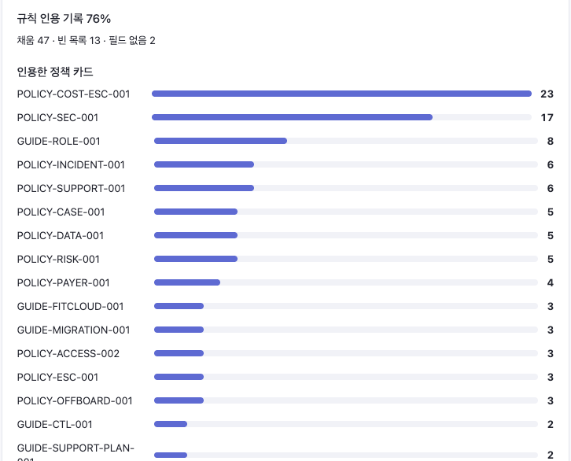
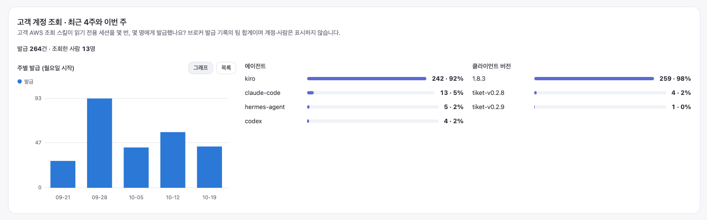

# 사용 지표

[← README](../README.md)

팀 사이트의 **사용 지표** 화면이에요. 각 PC 가 보낸 숫자만 모아서 팀 합계로 보여 줘요 — 사람별 속도는 안 보여요.
무엇이 어떻게 모이는지는 [밖으로 나가는 데이터](data-and-lessons.md#밖으로-나가는-데이터)에 있어요.

> 화면은 2026-10-22 에 찍었어요(W36–W43). 빈 점은 그 주 건수가 5건 미만이라는 뜻이에요.
> 지표마다 무엇을 세고 무엇을 빼는지는 아래 [어떻게 세나](#어떻게-세나)에 있어요.

## A · B · D — 기록이 제대로 남는가

| 지표 | 뜻 |
|---|---|
| **A 검사 통과율** | tiket 기록 중 필수 항목과 작성 규칙을 채운 비율 |
| **D 기록 비율** | 해결한 티켓 중 tiket 으로 처리하고 기록을 남긴 비율. 알람·월간 보고서 티켓은 빼요 |
| **B 유사도** | AI 초안을 얼마나 고쳐서 보냈는지 — high ≥ 0.9 · mid 0.6~0.9 · low < 0.6 |

## C — 응답·해결 시간과 재오픈

MTTA 는 티켓 생성부터 첫 공개 답변까지, MTTR 은 해결까지의 달력 시간이에요(Zendesk 기준).
**두 선을 tiket 의 효과로 읽으면 안 돼요.** tiket 은 주로 어려운 티켓에 쓰여서 두 선은 같은 종류의 티켓이 아니고, tiket 쪽은 주당 건수도 적어요.

## 무엇이 걸리고, 어떤 규칙을 인용하나

검사 실패는 다음에 어떤 규칙을 고칠지 정하는 데 써요. 등급(`quick`·`standard`·`high-risk`)과 산출물은 기록 맨 위에 적힌 값을 그대로 세요.

## 고객 계정 조회

고객 AWS 조회 스킬이 읽기 전용 세션을 몇 번, 몇 명에게 발급했는지예요. 브로커 발급 기록의 팀 합계이고 계정·사람은 안 보여요.

## 어떻게 세나

모든 값은 **각 PC 가 보낸 가장 최근 보고 하나**를 사람마다 골라 더한 팀 합계예요. 숫자를 만드는 코드는 둘이에요 —
기록에서 세는 `scripts/report_usage.py`(A·검사 실패·분류·인용)와 Zendesk 에서 세는 `scripts/usage_zendesk.py`(B·C·D).

**공통으로 빼는 것**
- 평가 기록(고객명이 `합성고객`)은 어디에도 안 세요.
- 그 칸이 양식에 없던 때 쓴 옛 기록은 그 칸의 분포에서 빼요("미평가" — 실패가 아니에요).
- 주는 ISO 주(월요일 시작)예요. A 는 기록의 `작성일:`(없으면 `날짜:`), B·C·D 는 Zendesk 의 **해결한 날**로 주를 정해요. 최근 8주만 봐요.
- 화면의 빈 점은 그 주 건수가 5건 미만이라는 뜻이에요 — 선은 그리지만 믿지 말라는 표시예요.

| 지표 | 무엇을 | 어떻게 | 빼는 것 |
|---|---|---|---|
| **A 검사 통과율** | 그 주에 쓴 tiket 기록 | 지금 검사기(`check_ticket_record.py`)로 다시 채점해 통과 ÷ (통과 + 실패) | 날짜가 없거나 미래인 기록, 미평가 |
| **D 기록 비율** | 그 주에 해결된, 나에게 배정된 티켓 | 그중 tiket 기록이 있는 것 + 남의 담당 티켓을 도와 쓴 기록(`helped_with_record`) | 알람·월간 보고서(태그 `auto_notification`·`sla_excluded`·`monthly_report`, `auto_excluded` 로 따로 셈) |
| **B 유사도** | 기록이 있고 해결된 티켓 | `## 답변 초안` 과 **내가 쓴 공개 답변**을 `difflib` 로 비교(0~1). high ≥ 0.9 · mid 0.6~0.9 · low < 0.6 | 초안이나 내 공개 답변이 없는 티켓. 내 Zendesk id 를 못 읽으면 재지 않아요 |
| **C MTTA·MTTR** | D 와 같은 티켓 | Zendesk `reply_time_in_minutes`(첫 공개 답변까지)·`full_resolution_time_in_minutes`(마지막 해결까지)의 달력 시간. 평균은 사람별 합계를 더해 ÷ 건수(정확). 중앙값은 사람별 중앙값을 건수로 가중 평균한 근사(원값이 사이트에 없어서) | 알람·월간 보고서 |
| **C 재오픈율** | D 와 같은 티켓 | 재오픈이 한 번이라도 있었던 티켓 ÷ 해결한 티켓 | 같음 |
| **검사 실패 항목** | 실패한 기록 | 검사기가 정한 다섯 묶음(처리 방향·안전장치·기록 비어 있음·교훈·양식)에 걸린 **기록 수**. 한 기록이 여러 묶음에 걸리면 각각 셈 | 미평가 |
| **등급·산출물** | 모든 기록 | 기록 머리의 `등급:`·`산출물:` 앞부분(`high-risk (사유…)` 도 `high-risk`). 없으면 `missing`, 셋 중 아니면 `unclassified` | 그 칸이 없던 때의 기록 |
| **정책 인용** | 등급이 있는 기록 | `policy_ids:` 의 카드 id 를 셈. 채움·빈 목록·필드 없음으로도 나눔 | 같음 |
| **고객 계정 조회** | 브로커가 발급한 읽기 전용 세션 | 인터널 계정 브로커 발급 로그를 주별·에이전트별·클라이언트 버전별로 셈 | 계정·사람은 화면에 안 나와요 |

C 의 두 선(tiket 으로 처리 / 아님)은 같은 종류의 티켓이 아니에요 — tiket 은 주로 어려운 티켓에 쓰여요. 차이를 tiket 의 효과로 읽지 않아요.
